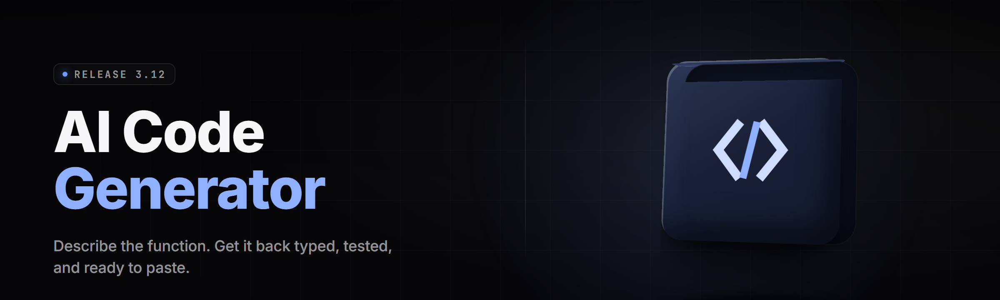

  
  
  

  

  
  
  

---

**AI Code Generator Studio 2026** — a desktop `.exe` that turns a sentence into a shipped module. 33 engines, 14 languages, one binary. No pip. No npm. No clones. Download, extract, run.

---

## 🧭 Table of Contents

- [Overview](#-overview)
- [What is AI Code Generator Studio](#-what-is-ai-code-generator-studio)
- [System Requirements](#-system-requirements)
- [Installation](#-installation)
- [Key Features](#-key-features)
- [The Problem](#-the-problem)
- [The Solution](#-the-solution)
- [Generation Engine Modules](#-generation-engine-modules)
- [Language & Framework Packs](#-language--framework-packs)
- [Workflow Modules](#-workflow-modules)
- [Comparison](#-comparison)
- [Known Issues](#-known-issues)
- [FAQ](#-faq)
- 

  

(#-download)

---

## 📦 Overview

AI Code Generator Studio 2026 ships as a single portable `.exe` for Windows. You type a spec — a sentence, a paragraph, a pasted ticket — and the studio emits runnable code across 14 target languages, wires the imports, drafts the tests, and hands you a diff you can accept block by block. It runs local models by default and can route to a hosted endpoint if you flip a switch. Nothing installs into your system PATH — extract the folder, double-click the `.exe`, and the studio boots its own bundled runtime.

| Category | Details |
|---|---|
| **Product type** | Windows desktop `.exe`, portable folder, no installer |
| **Core job** | Natural-language spec → multi-file code project |
| **Default runtime** | Local GGUF model (bundled quantized weights, ~4.1 GB) |
| **Optional runtime** | Bring-your-own API endpoint (OpenAI-compatible) |
| **Languages emitted** | Python, TypeScript, JavaScript, Rust, Go, C#, Java, C++, Kotlin, Swift, PHP, Ruby, SQL, Bash |
| **Project formats** | Single file, multi-file folder, monorepo patch, notebook |
| **Test generation** | pytest, Jest, Vitest, `cargo test`, Go `testing`, JUnit |
| **Version** | v2.6.3 (release build, March 2026) |
| **License** | MIT — fork it, rebrand it, ship your own packs |

The studio is built for people who already know what they want to build and don't want to fight a chat window to get it. You describe the module, it hands you the module, you review the diff. That loop is the whole product.

---

## 🎛️ What is AI Code Generator Studio

A glossary for the terms the rest of this doc leans on.

| Term | Explanation |
|---|---|
| **Spec** | Any natural-language input — one line, a paragraph, a pasted GitHub issue, a Jira ticket. The studio parses intent, not syntax. |
| **Engine** | A generation pipeline tuned for one job (e.g. the CLI-arg-parser engine, the REST-handler engine). 33 ship in the box. |
| **Target pack** | A language + framework bundle the studio can emit cleanly. 14 language packs, 9 framework overlays. |
| **Diff gate** | The review step where every generated block lands as a proposed patch. Nothing touches disk until you accept it. |
| **Repo context** | Files the studio reads from your existing project so generated code matches your style, imports, and conventions. |
| **Local mode** | Generation runs entirely on your machine via the bundled quantized model. No network calls. |
| **Remote mode** | Generation is routed to an OpenAI-compatible endpoint you configure. Useful for huge specs. |
| **Style profile** | A saved map of your conventions — naming, indentation, doc style — applied to every emitted file. |
| **Test scaffold** | Auto-generated test file stubs matched to the target pack's test runner. |
| **Patch export** | The studio's output as a real `.patch` or `.diff` you can `git apply` to any branch. |

The short version: a spec goes in, a reviewable patch comes out, and you stay in control of what lands.

---

## 🖥️ System Requirements

| Component | Minimum | Recommended |
|---|---|---|
| **OS** | Windows 10 21H2 (x64) | Windows 11 23H2+ |
| **CPU** | 4 cores, AVX2 | 8+ cores, AVX-512 or Apple-silicon-class ARM |
| **RAM** | 8 GB | 16 GB (24 GB for large-repo context) |
| **GPU** | Not required (CPU inference) | NVIDIA RTX 3060+ / 8 GB VRAM for GPU offload |
| **Disk** | 6.5 GB free (app + weights) | 20 GB free (weights + project cache) |
| **Runtime** | Bundled — nothing to install | Same |
| **Display** | 1280×720 | 1920×1080 or higher |
| **Admin rights** | Not required | Not required |

The `.exe` is self-contained. It does not need a Python install, a Node install, or a Visual C++ redistributable beyond what ships inside the folder.

---

## 🧰 Installation

Getting the studio running is a folder-extract, not a package manager.

1. **Visit the project page and grab the build.**
   Use the download block below. You get a `.zip` named `ai-code-generator-studio-v2.6.3-win-x64.zip`.

2. **Extract the archive anywhere you have write access.**
   Right-click → *Extract All* on Windows 11, or use 7-Zip. Keep the whole folder together — the `.exe` expects its `models/` and `packs/` siblings to sit next to it. Avoid extracting into `Program Files` (Windows will sandbox writes to the project cache).

3. **Run the `.exe`.**
   Double-click `.exe` inside the extracted folder. First launch unpacks the bundled weights into `./cache` (about 40 seconds), then the studio window opens. No admin prompt, no registry writes, no background service. To uninstall, delete the folder.

---

## 🧠 Key Features

| Feature | Description | Benefit |
|---|---|---|
| **33 generation engines** | Specialized pipelines per job — CLI parsers, REST handlers, data loaders, regex builders, migration writers, and 28 more. | You stop prompting the same generic model to "be a REST handler." The engine already is one. |
| **14 language packs** | Each pack encodes idiomatic patterns, formatter rules, and import ordering for its language. | Output reads like a human wrote it in that language, not a translation. |
| **Diff gate review** | Every block lands as a proposed patch with accept/reject/edit controls. | Nothing silently overwrites your files. You approve each hunk. |
| **Repo-aware context** | Point the studio at a folder; it indexes symbols and imports so new code matches what's there. | Generated modules compile against your actual codebase, not a toy example. |
| **Test scaffolds** | Auto-writes test stubs matched to the target runner, seeded with the function signatures you just generated. | You get a failing test the moment a function exists — TDD without the setup tax. |
| **Local-first inference** | Bundled quantized model runs on CPU by default, GPU offload when available. | No API key required, no per-token cost, no spec leaving your machine. |
| **Remote mode** | Flip to an OpenAI-compatible endpoint for very large specs. | You choose speed vs. privacy per project. |
| **Style profiles** | Save naming, indent, and doc conventions; apply them to every emission. | Consistent code across a whole team without a linter fight. |
| **Patch export** | Emit a real `.patch`/`.diff` instead of pasting code. | Fits into whatever review workflow you already use. |
| **Multi-file projects** | One spec can generate a folder tree — router, handler, model, test, README. | Scaffold a whole module in one pass. |
| **Notebook mode** | Emit `.ipynb` cells with markdown explanations between code. | Data-science specs become runnable notebooks. |
| **Offline packs** | Download language packs once; use them forever with no network. | Works on air-gapped machines and planes. |

---

## 🩹 The Problem

Plain chat windows are amazing at explaining code and mediocre at shipping it.

- **Context amnesia** — you paste your project structure, the model forgets it three messages later, and the next file it writes imports the wrong module.
- **One model, every job** — the same assistant that writes your Dockerfile also writes your regex, and both come out mediocre because neither got a specialized pipeline.
- **No review surface** — generated code arrives as a wall of text you copy-paste by hand, then debug for twenty minutes because you missed one line.
- **Test tax** — you write the function, then hand-write the test stub, then stub the mocks, and the actual test never happens.
- **Style drift** — every file the assistant writes uses a slightly different naming convention, so your linter screams.
- **Cloud-only** — proprietary code leaves your machine just to get a helper function, which is a non-starter for a lot of teams.
- **No diff, no history** — you can't `git apply` a chat message, so your own repo history has no record of what the tool did.

---

## 🧩 The Solution

| Problem | Solution in Studio |
|---|---|
| Context amnesia | Repo-context indexer reads your folder once per project and re-injects symbols on every generation. |
| One model, every job | 33 specialized engines, each tuned for one class of output. |
| No review surface | Diff gate presents every block as a reviewable hunk before it touches disk. |
| Test tax | Test scaffolds emit alongside every generated function, matched to your runner. |
| Style drift | Style profiles pin naming, indent, and doc conventions across all emissions. |
| Cloud-only | Local-first mode with bundled weights; remote mode is opt-in. |
| No diff, no history | Patch export produces real `.patch`/`.diff` files for `git apply`. |

---

## ⚙️ Generation Engine Modules

Each row below is a **working** engine in v2.6.3. Status reflects the release build.

| Module | Status | Description |
|---|---|---|
| `engine.rest_handler` | ✅ Working | Emits route + handler + validation for Express, FastAPI, Axum, Gin. |
| `engine.cli_parser` | ✅ Working | Arg parsing with help text, subcommands, and typed flags. |
| `engine.data_loader` | ✅ Working | CSV/Parquet/JSON loaders with schema inference and chunking. |
| `engine.regex_builder` | ✅ Working | Natural-language regex with a test-string harness. |
| `engine.migration_writer` | ✅ Working | Alembic, Prisma, SQLAlchemy, Flyway migration stubs. |
| `engine.dockerfile` | ✅ Working | Multi-stage Dockerfiles matched to the detected language. |
| `engine.test_scaffold` | ✅ Working | pytest, Jest, Vitest, `cargo test`, Go `testing`, JUnit. |
| `engine.state_machine` | ✅ Working | Explicit FSM code from a transition table. |
| `engine.schema_validator` | ✅ Working | Zod, Pydantic, JSON Schema, and runtime validators. |
| `engine.sql_query` | ✅ Working | Parameterized queries with joined-table awareness. |
| `engine.graphql_schema` | ✅ Working | SDL + resolvers + types, matched to your data layer. |
| `engine.grpc_stub` | ✅ Working | `.proto` + generated server/client stubs. |
| `engine.env_config` | ✅ Working | `.env` template + typed config loader. |
| `engine.logging_setup` | ✅ Working | Structured logging bootstrap per framework. |
| `engine.auth_middleware` | ✅ Working | JWT/session/API-key middleware scaffolds. |
| `engine.rate_limiter` | ✅ Working | Token-bucket and sliding-window limiters. |
| `engine.retry_wrapper` | ✅ Working | Exponential backoff with jitter, per-language idioms. |
| `engine.cache_layer` | ✅ Working | In-memory, Redis, and file caches with TTL helpers. |
| `engine.queue_worker` | ✅ Working | Celery, RQ, BullMQ, and asyncio task workers. |
| `engine.webhook_receiver` | ✅ Working | Signature-verified webhook endpoints for common providers. |
| `engine.websocket_server` | ✅ Working | Socket.IO, `ws`, and `tokio-tungstenite` servers. |
| `engine.file_watcher` | ✅ Working | Cross-platform file-watch loops with debounce. |
| `engine.cron_scheduler` | ✅ Working | Cron-style jobs mapped to APScheduler, node-cron, tokio-cron. |
| `engine.email_sender` | ✅ Working | SMTP + provider-API senders with templating. |
| `engine.pdf_report` | ✅ Working | PDF builders via ReportLab, Puppeteer, WeasyPrint. |
| `engine.csv_exporter` | ✅ Working | Streamed CSV exporters for large result sets. |
| `engine.image_pipeline` | ✅ Working | Resize/convert/thumbnail pipelines per language. |
| `engine.markdown_render` | ✅ Working | Markdown → HTML pipelines with syntax highlighting. |
| `engine.i18n_loader` | ✅ Working | i18n bundles + locale switchers. |
| `engine.feature_flags` | ✅ Working | Flag clients + typed flag accessors. |
| `engine.error_taxonomy` | ✅ Working | Typed error hierarchies matched to your domain. |
| `engine.cli_progress` | ✅ Working | Progress bars + spinners per ecosystem. |
| `engine.benchmark_harness` | ✅ Working | Micro-benchmark scaffolds using each language's native bench tool. |

**Engine categories** — the 33 above group into five families:

**🌐 Network & API** — rest_handler, graphql_schema, grpc_stub, websocket_server, webhook_receiver, rate_limiter, auth_middleware.

**🗃️ Data & Persistence** — data_loader, migration_writer, sql_query, cache_layer, csv_exporter, schema_validator.

**🧵 Concurrency & Scheduling** — queue_worker, cron_scheduler, retry_wrapper, file_watcher, state_machine.

**🖋️ Output & Reporting** — pdf_report, markdown_render, image_pipeline, cli_progress, email_sender.

**🧪 Quality & Ops** — test_scaffold, benchmark_harness, logging_setup, env_config, dockerfile, error_taxonomy, feature_flags, i18n_loader, regex_builder.

---

## 🗂️ Language & Framework Packs

| Pack | Coverage | Idioms Encoded |
|---|---|---|
| **Python 3.12** | FastAPI, Flask, Django, plain scripts | Black formatting, type hints, dataclasses. |
| **TypeScript 5.x** | Express, Fastify, Next.js, tRPC | Strict mode, ESM, `satisfies` operator patterns. |
| **JavaScript (ESM)** | Node 20+, browser modules | ESM only, no CommonJS emission unless forced. |
| **Rust 1.78** | Axum, Actix, Tokio, Clap | `Result`/`?` propagation, `thiserror` hierarchies. |
| **Go 1.22** | net/http, Chi, Gin | Explicit error returns, context plumbing. |
| **C# 12** | ASP.NET Core, minimal APIs | Nullable reference types, records. |
| **Java 21** | Spring Boot, plain JVM | Records, sealed interfaces, virtual threads. |
| **C++ 20** | CMake + modern STL | RAII, `std::expected` patterns. |
| **Kotlin 2.0** | Ktor, Android | Coroutines, sealed classes. |
| **Swift 5.10** | Vapor, iOS | Structured concurrency, `Codable`. |
| **PHP 8.3** | Laravel, plain FPM | Typed properties, enums, attributes. |
| **Ruby 3.3** | Rails, Sinatra | `frozen_string_literal`, keyword args. |
| **SQL (Postgres/MySQL)** | Migrations, queries | Parameterized only, no string concatenation. |
| **Bash 5** | POSIX-safe scripts | `set -euo pipefail`, quoted expansions. |

Nine framework overlays (FastAPI, Express, Next.js, Axum, Gin, Spring Boot, Rails, Laravel, Vapor) tune the emission further.

---

## 🧪 Workflow Modules

| Module | Status | Description |
|---|---|---|
| `workflow.diff_gate` | ✅ Working | Per-hunk review UI before any file write. |
| `workflow.repo_indexer` | ✅ Working | Symbol + import index for a chosen project folder. |
| `workflow.style_profiles` | ✅ Working | Saved convention maps applied to every emission. |
| `workflow.patch_export` | ✅ Working | `.patch`/`.diff` emitter for `git apply`. |
| `workflow.spec_history` | ✅ Working | Searchable log of every spec you've run this session. |
| `workflow.engine_chain` | ✅ Working | Compose engines — e.g. rest_handler → test_scaffold → dockerfile. |
| `workflow.template_library` | ✅ Working | Save a generated output as a reusable template. |
| `workflow.offline_mode` | ✅ Working | Hard-block network calls; use bundled packs only. |

---

## 🆚 Comparison

| Aspect | Typical Chat Assistant | Code-Completion IDE Plugin | This Tool |
|---|---|---|---|
| **Input format** | Chat message | Partial line / comment | Any spec: line, paragraph, ticket |
| **Output format** | Wall of text | Inline completion | Reviewable patch + real `.patch` file |
| **Multi-file projects** | Manual copy-paste | One file at a time | Full folder tree in one pass |
| **Repo awareness** | Manual paste each turn | Yes, editor scope | Folder index, re-injected each generation |
| **Test generation** | If you ask | Rarely | Built-in, matched to runner |
| **Runs offline** | No | Partially | Yes, local-first by default |
| **Engine specialization** | One model, all jobs | One model, all jobs | 33 specialized engines |
| **Style consistency** | You re-prompt | Editor defaults | Saved style profiles |
| **Language coverage** | Broad, shallow | Broad, shallow | 14 deep packs |
| **Review granularity** | Whole response | Whole file | Per-hunk diff gate |
| **Distribution** | Cloud service | Plugin marketplace | Portable `.exe`, no installer |

---

## ⚠️ Known Issues

| Issue | Solution |
|---|---|
| First launch takes ~40 seconds to unpack weights. | Expected. Subsequent launches are instant; weights stay in `./cache`. |
| GPU offload not detected on some laptop GPUs. | Set `STUDIO_GPU=force` in `./config.ini` and restart the `.exe`. |
| Repo indexer is slow on folders > 50k files. | Point it at a subfolder, or add the subfolder to `./config.ini` under `[indexer] exclude`. |
| Remote mode fails behind a corporate proxy. | Set `HTTPS_PROXY` in `./config.ini`; the studio reads it at boot. |
| Emitted Rust sometimes warns on unused imports. | Run `cargo fix --allow-dirty` after applying the patch. |
| Notebook mode drops markdown cells on very long specs. | Split into multiple runs; each run caps at 40 cells by default. |

---

## ❓ FAQ

**1. Do I need Python, Node, or any package manager installed?**
No. The `.exe` bundles its own runtime and the model weights. You extract the folder and run the `.exe`. Nothing gets added to your PATH, no environment variables, no registry entries.

**2. Does the studio send my code anywhere?**
Only if you turn on remote mode. Local mode is the default and makes zero network calls — you can verify by running the studio with Wi-Fi off. Offline mode hard-blocks outbound traffic even if remote is misconfigured.

**3. What model is bundled?**
A quantized general-purpose code model tuned for instruction-following, shipped in GGUF format inside `./models`. You can drop in your own GGUF by editing `./config.ini`. Version and quant level are printed on the splash screen.

**4. How big is the download?**
The full archive is around 4.6 GB. That's the `.exe`, the bundled runtime, and the quantized weights. Language packs add ~120 MB total if you grab all 14.

**5. Can I use the generated code commercially?**
Yes. The MIT license covers the studio. The code you generate is yours — the studio makes no claim on output. Standard caveat: review everything before you ship it, same as you would with any code you didn't hand-write.

**6. Why 33 engines instead of one big prompt?**
Because a general model told to "be a REST handler" produces mediocre REST handlers. A pipeline tuned for REST handlers produces good ones. The engines are small, specialized, and composable via `workflow.engine_chain`.

**7. Will it work on Windows Server or WSL?**
Windows Server 2022 works if it has the Desktop Experience feature. WSL2 is unsupported — the `.exe` is a native Windows binary and needs a real window session.

**8. How do updates work?**
Nothing auto-updates. You check the project page, download the new build, extract over the old folder (keep your `./config.ini` and `./cache` if you want), and run the new `.exe`. Your style profiles and templates live in `./user/` and survive the swap.

**9. Does it touch my existing project without asking?**
Never. Every generated block goes through the diff gate. You approve each hunk. The only thing it writes without review is the `./cache` and `./user` folders inside its own directory.

**10. Is there a CLI version?**
Not in v2.6.3. The engine chain is exposed through the GUI only for now; a headless `--spec` mode is on the roadmap for v2.7.

---

## ⬇️ Download

Grab the current build from the project page. The archive contains the `.exe`, bundled weights, and all 14 language packs.

  

---

The studio exists because shipping code and explaining code are two different jobs, and only one of them pays the rent. If you've ever pasted a ticket into a chat window and then spent twenty minutes separating the actual code from the commentary around it, this tool is aimed at you. Build it, review the diff, apply the patch, move on. MIT-licensed, portable, offline by default — fork it and make it yours.

  

